<p align="center">
  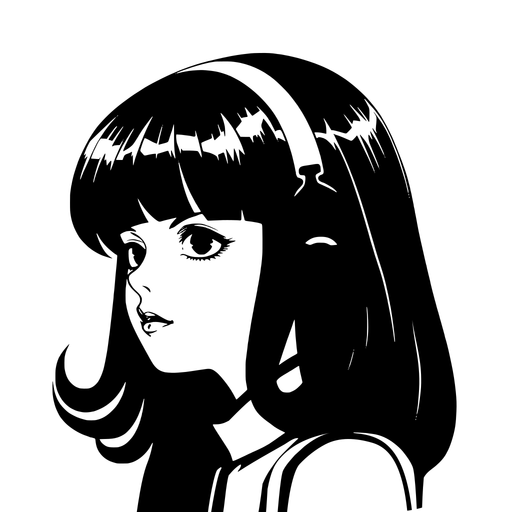
</p>

<h1 align="center">Hermes Remote</h1>

<p align="center">
  Control center lokal untuk Hermes Agent.<br>
  Model, memori, skills, dan settings — di mesin kamu, bukan di cloud.
</p>

<p align="center">
  <a href="https://www.npmjs.com/package/hermes-remote"></a>
  <a href="LICENSE"></a>
  
  
</p>

<p align="center">
  <code>npm install -g hermes-remote</code>
</p>

---

## Kenapa ini

Hermes Agent hidup di mesin lokal. Mengutak-atik model, memori, dan skills lewat file mentah cepat jadi berantakan. Hermes Remote membuka satu halaman di `localhost` untuk itu.

Tidak ada akun. Tidak ada data yang dikirim ke server kami. PIN hanya menjaga sesi di mesin itu.

## Fitur utama

- **Panel kontrol lokal** — status proses, RAM, disk, dan model/provider dalam satu halaman.
- **Notion terintegrasi** — dropdown halaman, render 1:1 via API, tree navigasi, breadcrumb, dan modal. Lihat/baca halaman langsung dari panel.

- **Mobile-first & responsif** — drawer off-canvas, header fixed full-width, toast responsif + keyboard. Enak di HP maupun desktop.
- **Auth-once** — sekali masukkan PIN, sesi bertahan; tak perlu login ulang tiap buka.
- **Bebas cloud** — semua data tetap di mesin lokal; PIN hanya menjaga sesi.

## Pasang

Butuh Node.js 16+ dan Python 3.8+. Python cukup yang sudah ada di sistem.

```bash
npm install -g hermes-remote
hermes-remote
```

Buka [http://localhost:8093](http://localhost:8093). PIN awal `123456`. Ganti sebelum halaman ini bisa dijangkau dari luar mesin.

Tanpa pasang global:

```bash
npx github:0xhannn/hermes-config-remote
```

## Di dalam halaman

| Halaman | Buat apa |
|---|---|
| Dashboard | Status proses lokal, RAM, disk |
| Brain | Lihat model aktif, ganti provider |
| Context | Baca dan ubah `USER.md` serta `MEMORY.md` |
| Skills | Lihat skill yang terpasang |
| Notion | Pilih halaman Notion, baca/render konten 1:1 |
| Settings | Ganti PIN, cadangan `tar.gz`, salin perintah update |

## Perintah

```bash
hermes-remote                  # port 8093, buka browser
hermes-remote -p 8090          # port lain
hermes-remote --no-open        # tanpa buka browser (VPS)
hermes-remote --host 0.0.0.0   # dengar di semua interface
hermes-remote --help
```

`--host 0.0.0.0` membuka halaman ke jaringan. Ganti PIN dulu.

## Update

Halaman Settings membandingkan versi lokal dengan npm. Kalau ada yang lebih baru, salin perintah ini, matikan server, jalankan di terminal:

```bash
npm install -g hermes-remote@latest
```

Halaman tidak menarik git dan tidak mematikan prosesnya sendiri.

## Changelog

**v1.0.21** — perbaikan paket npm: `notion/` & `cron/` kini ikut ter-publish (tab Notion tidak lagi 404).

**v1.0.20** — overhaul mobile (drawer off-canvas, header fixed, toast responsif), integrasi tab Notion render 1:1 via API, mode auth-once, perbaikan mojibake & sinkronisasi konten Brain/Skills.

## Isi repo

```text
bin/cli.js                  menu, nyalakan server, tray
server/hermes_brain_api.py  API lokal, port 8093
index.html                  dashboard
brain/  context/  skills/   halaman panel
notion/                     halaman Notion (render via API)
settings/  auth/            pengaturan dan pintu PIN
assets/                     gaya, ikon, suara
```

## Tangkapan layar

**Desktop** (1280×800) — Dashboard, Brain, Context, Skills:

| | |
|---|---|
| 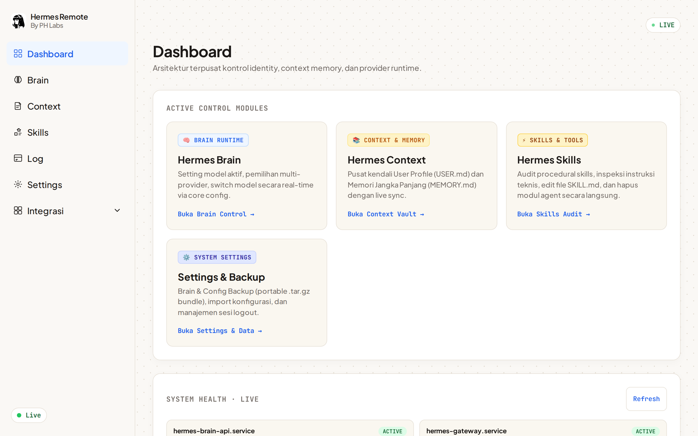 | 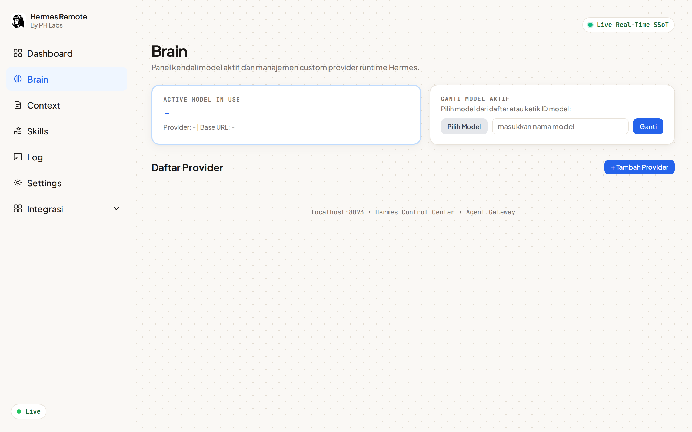 |
| 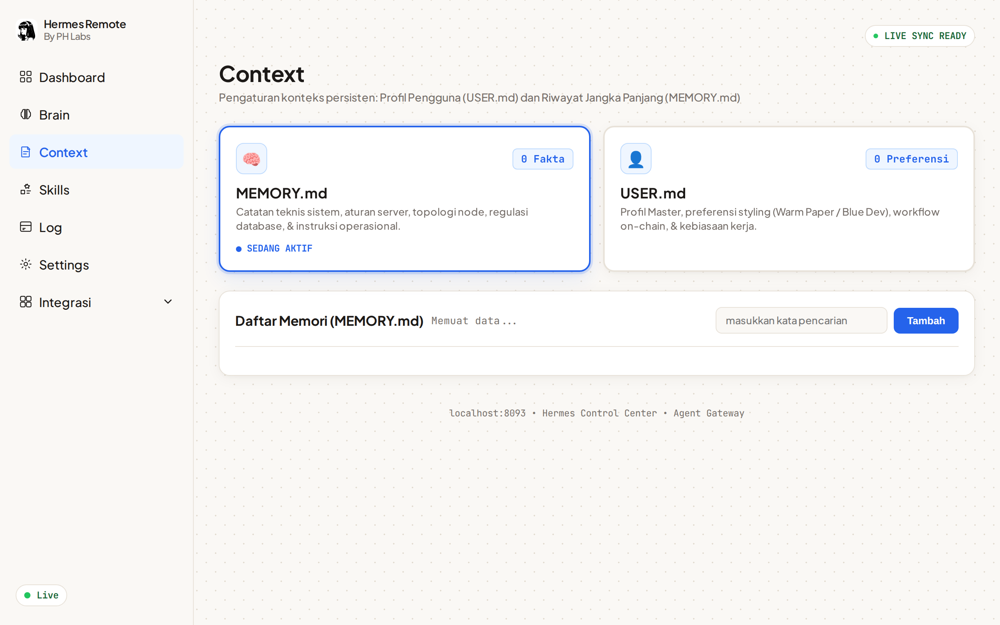 | 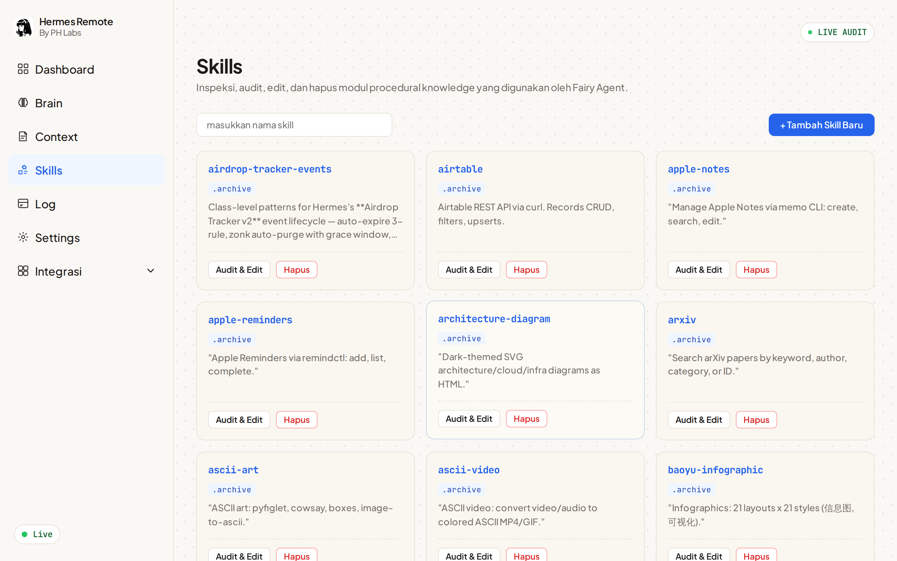 |

Desktop — Logs, Settings, dan integrasi Notion:

| | |
|---|---|
| 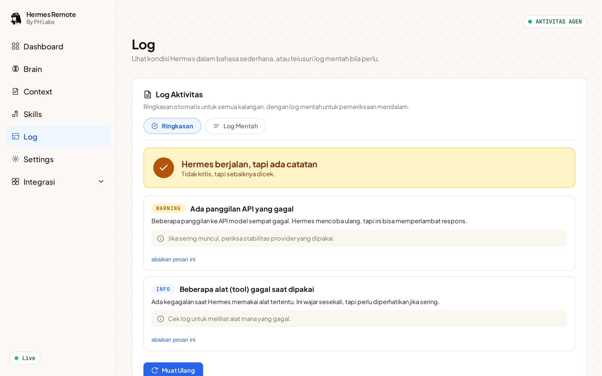 | 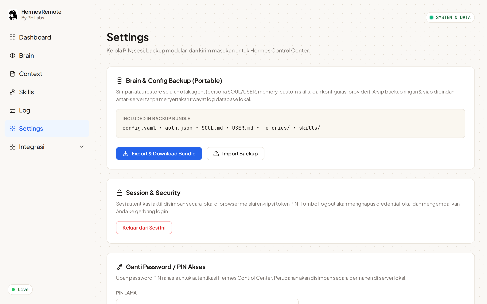 |
| 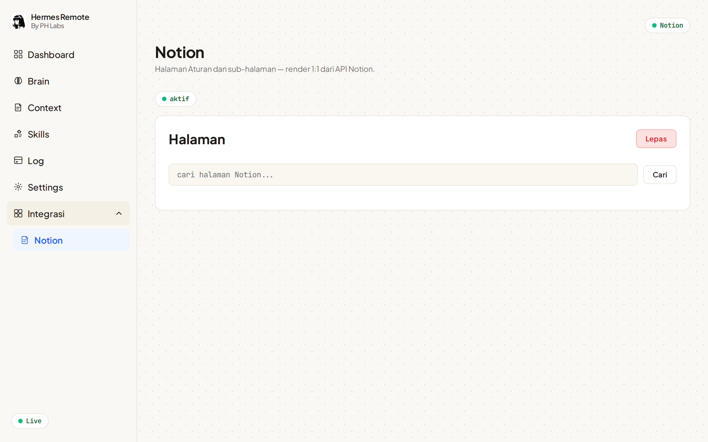 | |

**Mobile** (390×844):

| | |
|---|---|
| 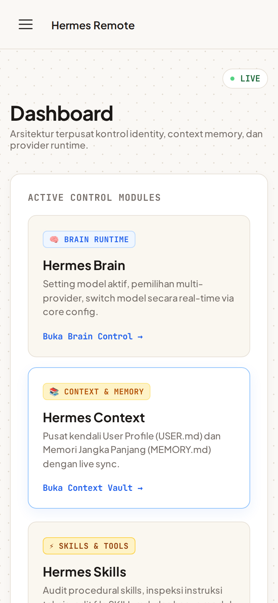 | 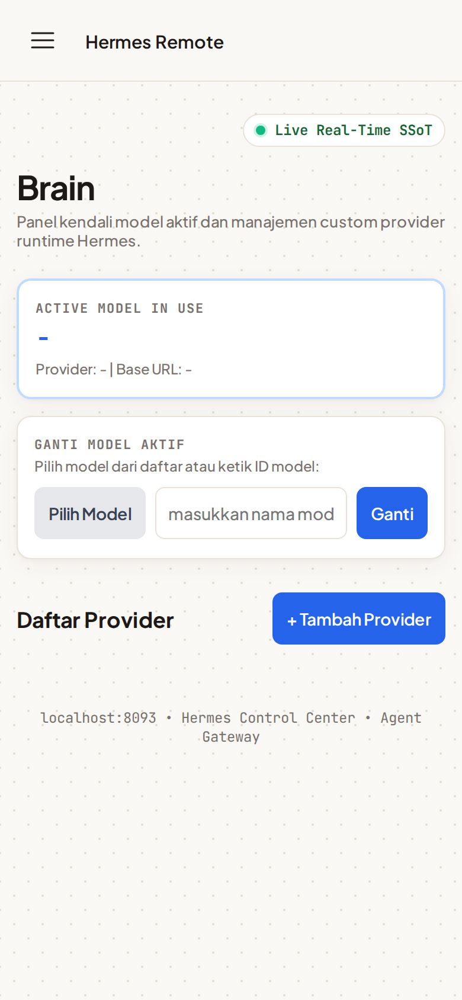 |
| 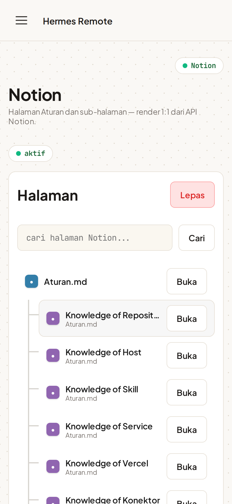 | |

## Lisensi

[MIT](LICENSE). Copyright (c) 2026 PH Labs.
